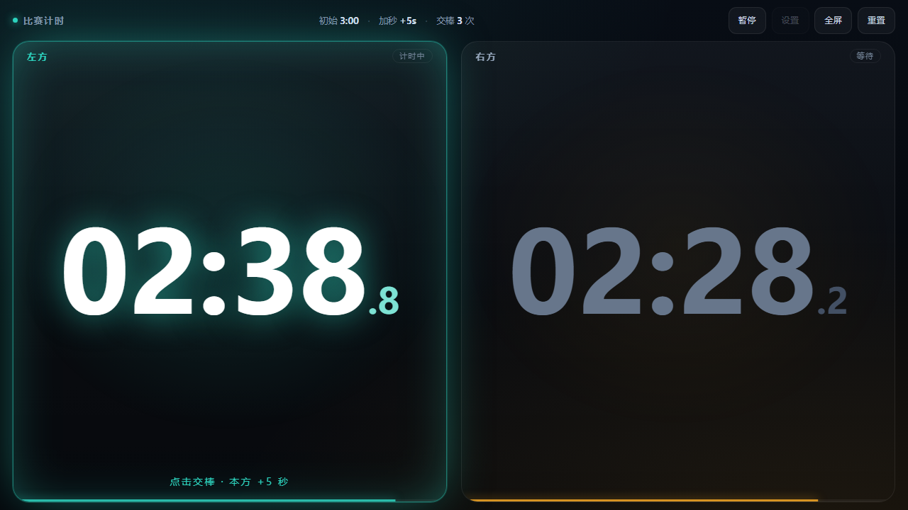
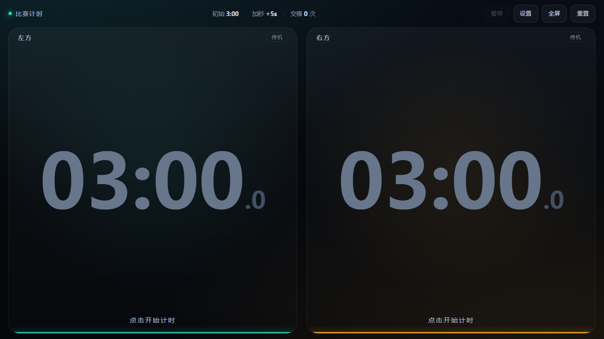
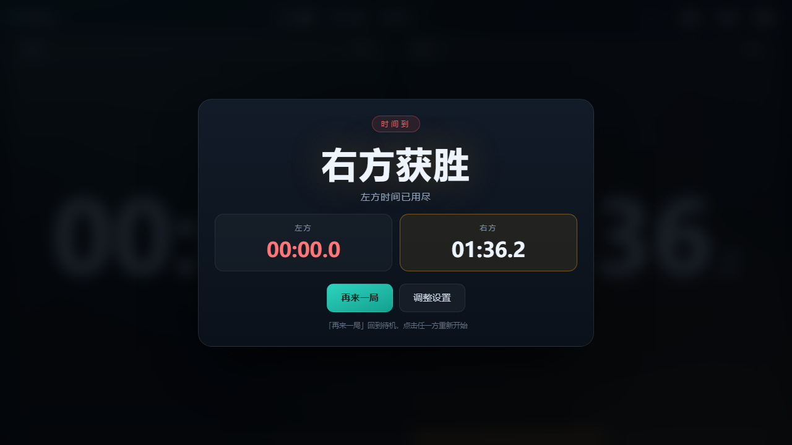
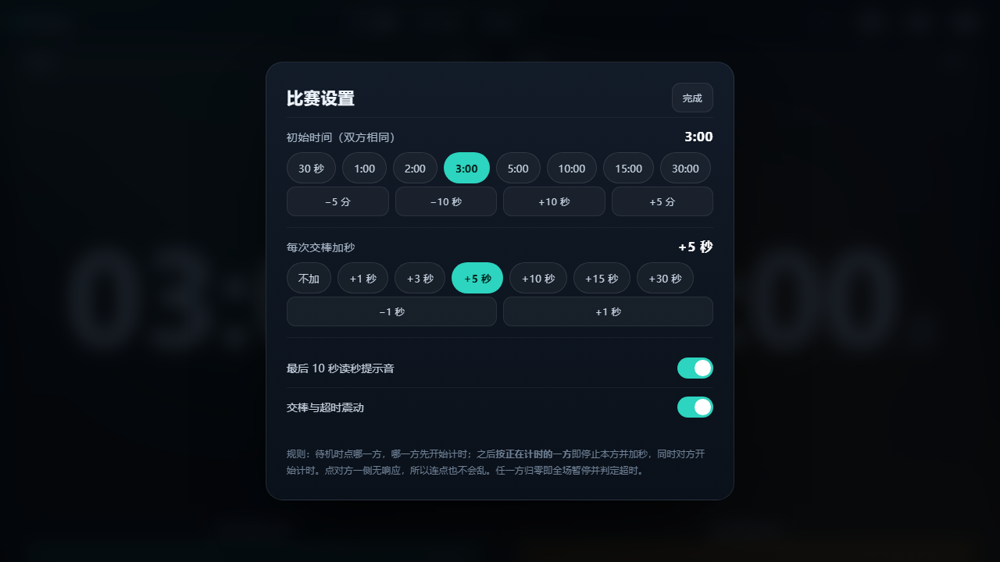

# 比赛计时 · Match Timer

一款给比赛 / 辩论 / 演讲 / 棋类对局用的双人计时器。横屏使用，左右各一方，**点正在计时的那一侧就交棒**，交棒时给刚结束的一方加秒——和真实棋钟一个手感。

安卓手机装 APK 即用；也可以用浏览器打开网页版，或部署到 GitHub Pages 后「添加到主屏幕」，当 PWA 用。



## 特性

- **整块面板就是按钮**：待机时点哪一侧，哪一侧先开始；计时中点正在走的那一侧 = 停止本方、+N 秒、对方开始
- **防误触**：只有正在计时的一侧响应，点对方一侧毫无反应，连点也不会把时间切乱
- 每次交棒加秒可设 `0 / 1 / 3 / 5 / 10 / 15 / 30` 秒，也能 ±1 秒微调
- 初始时间 30 秒 ~ 2 小时任选，支持 ±10 秒 / ±5 分微调
- 归零自动暂停全场 + 震动 + 提示音 + 判定胜负，并显示双方最终用时
- 最后 10 秒数字变红闪烁 + 读秒提示音（可单独关闭）
- 暂停 / 继续、重置二次确认、交棒次数统计
- 全屏锁定横屏、屏幕常亮、切到后台不丢时间
- 纯静态单文件网页，零依赖、零网络请求，完全离线可用

## 两种用法

### 方式一：安装 APK（推荐）

到 [Releases](../../releases/latest) 下载 `比赛计时.apk`（约 89 KB）：

1. 把 APK 传到手机（数据线 / QQ / 网盘；微信会拦截 apk 类型）
2. 点开安装，系统提示「未知来源」时选**允许**；若出现 Play 保护机制提示，选「仍然安装」
3. 桌面出现「比赛计时」图标，点开即全屏使用
4. 退出：**连按两次返回键**（防止比赛中误触丢失计时）

APK 只是原生全屏外壳，内部就是仓库里的 `index.html`，两者功能完全一致。

### 方式二：网页版 / PWA

- 本地：浏览器打开 `index.html`（或 `file:///存储路径/计时/index.html`）
- 线上：部署到 GitHub Pages 后，用手机浏览器打开站点，菜单里「添加到主屏幕」，就有独立图标、全屏启动和离线缓存（`manifest.webmanifest` + `sw.js` 已就绪）

> 本地 `file://` 打开时浏览器不会提供「添加到主屏幕」——PWA 安装要求 https 网址，这是浏览器限制，不是页面问题。

## 规则

| 项目 | 说明 |
| --- | --- |
| 初始时间 | 双方相同，30 秒 ~ 2 小时 |
| 开始 | 待机时**点哪一侧，哪一侧先开始计时** |
| 交棒 | **点正在计时的一侧**：本方停止并 +N 秒，对方立刻开始倒计时 |
| 加秒 | 第一个开始的一方不加秒；之后每次交棒按设定加给刚结束的一方 |
| 归零 | 任一方用尽 → 全场暂停 + 震动 + 提示音 + 弹出「某方获胜」 |
| 暂停 | 右上角「暂停 / 继续」；暂停时点正在计时的一侧也能继续 |
| 防误触 | 只认正在计时的一侧；点对方一侧无响应 |

> 举例（初始 3 分钟、加秒 5 秒）：点左方开始 → 左方走到 2 分 40 秒时点一下左方面板 → 左方变为 2 分 45 秒并停住，右方从 3 分钟开始倒计时。

## 界面

<p>
  
  
</p>

- 顶部条：初始时间、每次加秒、已交棒次数
- 亮色发光的一侧 = 正在计时；暗色 = 等待
- 面板底部小字提示此刻该做什么：点击开始 / 点击交棒 · 本方 +5 秒 / 点击继续

## 设置

点右上角「设置」（比赛中不可改，需先重置）：



设置保存在本机（`localStorage`），下次打开仍是上次的配置。

## 自己构建 APK

`android/` 是一个不依赖 Gradle 的极简工程，直接用 SDK 的 `aapt2 / d8 / apksigner` 打包：

1. 准备工具链目录（含三个子目录）：
   - `jdk/` — JDK 17
   - `bt/` — Android SDK Build-Tools 34（含 `aapt2`、`d8`、`zipalign`、`apksigner`）
   - `platform/` — Android SDK Platform（`android.jar`）
2. 运行：

```powershell
powershell -ExecutionPolicy Bypass -File .\android\build.ps1 -Toolchain "D:\android-toolchain"
```

脚本会把源码复制到英文临时目录编译（aapt2 不支持非 ASCII 路径），产物默认输出到仓库根目录的 `比赛计时.apk`。

构建目标：compileSdk 35 / minSdk 24（Android 7.0+）/ targetSdk 34，APK 采用 v2 + v3 签名。

## 目录结构

```
.
├─ index.html              # 网页版主程序（单文件，样式与逻辑都在里面）
├─ manifest.webmanifest    # PWA 清单
├─ sw.js                   # PWA 离线缓存
├─ icons/                  # PWA 图标
├─ screenshots/            # 文档截图
├─ android/                # APK 工程（Manifest、MainActivity、图标、打包脚本）
└─ LICENSE
```

## 更新日志

- **v1.1** — 交互改为「点计时侧即交棒」，去掉中间按钮，面板占满半屏
- **v1.0** — 初版：中间大按钮交棒、加秒、归零判定

## License

[MIT](LICENSE)
